<p align="center">
  
</p>

<p align="center">
  <a href="https://github.com/Vainnor/nixos/actions/workflows/secrets.yml"></a>
    
</p>
<p align="center">
    <a href="TODO.md"></a>
</p>

---

NixOS for **arc** (Ryzen 7 9800X3D · RX 7900 XTX · 32 GB), dual-booting with Windows on its own
drive, plus the MacBook through nix-darwin. **One flake describes both, and one command installs the PC.**
The layout is [dendritic](https://vimjoyer.com/nix/dendritic/): every file under `modules/` is a
flake-parts module for one feature, holding its NixOS and home-manager halves side by side. A machine
is just the list of aspects it picks.

<p align="center">
  
</p>

## What's in it

| Aspect | What you get |
|---|---|
| `base` | systemd-boot via lanzaboote, LUKS + TPM, impermanence, NetBird, SSH (NetBird only), sops, fish, hourly snapshots, restic, USBGuard, Prometheus exporters |
| `desktop` | Mango, greetd, waybar, fuzzel (apps, emoji, calculator, files), swaync, swayosd, gtklock, Plymouth, night light, PipeWire channels, Stylix, 1Password, Thunar, Cider, Vesktop, TeamSpeak |
| `gaming` | Steam + Proton-GE, gamescope, gamemode, MangoHud, LACT (GPU fans), CoolerControl (CPU and case fans), instant replay, Sunshine, scx_lavd, Xbox/PlayStation controllers |
| `streaming` | OBS seeded with the Vainnor overlays: a profile, 3 themed scene collections, BEACN-style audio tracks, global hotkeys, an EasyEffects mic chain, Chatterino |
| `dev` | Zed, vis, git signed through 1Password, direnv + nix-direnv, nix-ld, rootless Docker, kubectl, k9s, OpenTofu, Ansible, per-project toolchains for Python, TS/JS, Java, Go, PHP, Rust and C/C++ |
| `vm` | libvirt: `win11` with the 7900 XTX passed through, `win11-lite` in a window, WinApps |
| `privacy` | i2pd, and a LibreWolf profile that only talks through it |
| `browser` | LibreWolf with Sidebery (vertical tabs), Stylus and 1Password, the tab strip hidden, square corners, about: pages in the system palette (on the Mac too) |

Shared values (user, theme, wallpaper, monitors, audio output, VFIO addresses) live in
`modules/flake/meta.nix`. **Change `theme` there and everything re-themes.** The look is flat
and square everywhere (no rounded corners, shadows or blur, lowercase text labels), and the colours
come from the wallpaper (see [Wallpapers](#wallpapers)).

## Built with

Versions are the ones pinned in `flake.lock` today; `just update` moves them.

| Layer | Tool | Version |
|---|---|---|
| **System** |  | `26.11 unstable` |
|  |  | `7.3.1` |
|  |  | `2.34.9` |
| **Flake** |  |  |
|  |  |  |
|  |  |  |
| **Desktop** |  |  |
|  |  | `1.4.0` |
|  |  | `159.0` |
|  |  | `1.15.0` |
|  |  | `0.15.0` |
|  |  |  |
| **Graphics** |  | `26.2.6` |
|  |  | `1.6.9` |
| **Gaming** |  | `Proton GE 11-11` |
|  |  | `3.17.0` |
|  |  | `2026.914` |
|  |  | `1.1.4` |
|  |  | `6.1.6` |
| **Streaming** |  | `32.2.2` |
| **Dev** |  | `1.26.2` |
|  |  |  |
|  |  |  |
| **Security** |  | `1.2.0` |
|  |  |  |
|  |  | `3.13.3` |
|  |  |  |
|  |  |  |
| **Network** |  | `0.82.0` |
|  |  |  |
| **Backups** |  | `0.32.7` |
|  |  | `0.19.1` |

## Three things to know before changing anything

1. **The installer only ever erases one disk.** It finds the Crucial P310 by model, refuses anything with
   Windows or NTFS on it, and waits for you to type `YES`. The Windows drives are never named anywhere.
2. **`/` is wiped on every boot.** Anything not declared here or listed in
   `modules/system/impermanence.nix` is gone after a reboot. `just ephemeral` shows what would be lost.
3. **The repo is public; secrets are not.** They're sops-encrypted in `secrets/`, and CI fails on anything
   that looks like a leaked credential. The Mac's age key is the one thing this repo can't rebuild.

## Install

Before you start: turn off Fast Startup in Windows and Secure Boot in the BIOS. Secure Boot can be turned back on later with lanzaboote.

Boot any NixOS installer USB. Connect Ethernet, or run `nmtui` for Wi-Fi. Then run:

```
sudo nix --extra-experimental-features 'nix-command flakes' run github:vainnor/nixos
```

The installer:
- finds the 1TB Crucial P310 by its model name;
- refuses to continue if it finds Windows/NTFS partitions on it, or if it's the USB stick;
- shows the disk and waits for you to type `YES`;
- asks for the disk-encryption password and your login password, then installs.

When it finishes, reboot. Choose the NixOS drive with F11 if Windows starts instead. Log in, then run `sudo netbird up`.

**Optional custom ISO**: the installer is preloaded, so you just run `sudo install-nixos`.
`nix build .#nixosConfigurations.installer.config.system.build.isoImage` (on x86_64 Linux; WSL works).

## Impermanence

`/` is a RAM disk that gets wiped on every boot. Only the following survive:
- `/nix` (the system),
- `/home` (your files),
- `/var/log`,
- what `modules/system/impermanence.nix` lists under `/persistent`.

If a service forgets its state after a reboot, add its directory to that list.
Because `/etc/shadow` is wiped as well, your password is stored as a hash in `/persistent/passwords/<user>`. To change it:

```
mkpasswd -m yescrypt | sudo tee /persistent/passwords/vainnor
```

## After installing (once)

<details>
<summary><b>Secure Boot + TPM unlock</b></summary>

1. On first boot, your own Secure Boot keys are created in `/var/lib/sbctl` (kept on `/persistent`).
2. Reboot into the BIOS. Go to *Security > Secure Boot*, set the mode to **Custom**, then **delete all keys** (this is Setup Mode). Save and reboot. systemd-boot enrolls your keys plus Microsoft's; Windows and the GPU's option ROM need Microsoft's.
3. Back in the BIOS, turn Secure Boot **on**. Then run `just secureboot-status`. It should show *Secure Boot: enabled*.
4. Run `just tpm-enroll`. From then on the disk unlocks automatically as long as the Secure Boot state is unchanged. Your passphrase still works as a fallback.

</details>

<details>
<summary><b>Secrets (sops)</b></summary>

`secrets/secrets.yaml` is encrypted (it holds the Twitch stream key and the StreamElements ID and token). Only the recipients in `.sops.yaml` can open it.
1. The installer prints the PC's age key, and also saves it in `~/nixos/HOST_AGE_KEY.txt`. `just secrets-host` shows it again.
2. On the Mac, run `just secrets-add-host age1...`. This re-encrypts the file for the PC and sets `meta.secretsReady = true`.
3. Run `just secrets-edit` to fill in real values, then `just commit "..."` and `just deploy`.

What's in there: the Twitch key and StreamElements token, the WinApps password, your Wi-Fi (`wifi/ssid`, `wifi/psk`), a NetBird setup key (`netbird/setup_key`, so the PC joins the mesh by itself) and the restic target (see Backups).

</details>

<details>
<summary><b>1Password</b></summary>

Sign in once, then in *Settings > Developer* turn on **Use the SSH agent** and **Integrate with 1Password CLI**. SSH and git signing then go through 1Password, and the LibreWolf extension connects to the app. Commits are signed with `meta.signingKey`; add it on GitHub as a **signing key** so they show as Verified. The key has to be in your 1Password vault, otherwise `git commit` fails.

</details>

<details>
<summary><b>Fan curves</b></summary>

Open **CoolerControl** from the launcher. Pick a fan, make a curve against a temperature (CPU, liquid, GPU), and apply it. The curves keep running after you close the app. For a quick switch, make a "quiet" and a "gaming" mode.
- Leave the graphics card's fans to **LACT**. Giving them a curve in CoolerControl too makes the two programs fight over the fan.
- If a case fan shows a speed but won't change, set its control mode to PWM in the BIOS (Hardware Monitor) first.
- `just fans-save` copies your curves into the repo; commit them. A reinstall then starts with the same curves.

</details>

<details>
<summary><b>Backups</b></summary>

- **Snapshots** (already on): `@home` and `@persistent` every hour, kept 48 h / 14 days / 6 weeks. `just snapshots` lists them; old files are under `/.btrfs/@snapshots/`. They live on the same disk, so they protect against mistakes, not against a dead drive.
- **restic to the homelab**: put the repository URL, a password and (for S3/MinIO) keys in `restic/*` with `just secrets-edit`, then set `meta.resticReady = true` and deploy. It runs nightly at 03:30 (or at the next boot if the PC was off). `just backup` runs it now, `just restore <path>` gets files back.

</details>

<details>
<summary><b>LibreWolf (Sidebery and Stylus)</b></summary>

The extensions, the sidebar layout and both stylesheets are in the config. What each extension
keeps inside itself is not: export it once on the Mac and import it on the PC.

- **Sidebery**: *Settings > Help > Export addon data*, then *Import addon data* on the PC.
- **Stylus**: *Manage > Backup > Export*, then *Import* on the PC.

Keep the two exports somewhere safe (1Password works). The stylesheets are in `assets/librewolf/`;
`userContent.css.in` takes its colours from the theme, so edit the rules there, not the colours.

</details>

<details>
<summary><b>Monitoring</b></summary>

Add `arc.netbird.cloud:9100` (node exporter) and `arc.netbird.cloud:9633` (SMART) as scrape targets in the homelab's Prometheus. Both ports are only open on NetBird.

</details>

<details>
<summary><b>Sunshine (game streaming)</b></summary>

Open `https://localhost:47990` on the PC, create the admin login, then pair Moonlight (Mac, phone, TV) with the PIN it shows. Works over NetBird when you're away.

</details>

<details>
<summary><b>USB devices</b></summary>

Devices that are plugged in at boot always work, and everything connected on the first boot is remembered. A new device plugged in later is blocked and a notification says so: `just usb` shows it, `just usb-allow <n>` allows it for good.

</details>

<details>
<summary><b>Homelab binary cache (Attic)</b></summary>

Once the homelab runs Attic, put its endpoint, cache name and public key in `meta.binaryCache` and the
push token in the secrets (`attic/token`), then deploy. Both machines download from it first, and the PC
pushes everything it builds, so the Mac and any reinstall reuse those builds. If the homelab is down, Nix
gives up on it after 5 seconds and carries on. `just cache-push` pushes the running system by hand.

</details>

<details>
<summary><b>Windows VM with the GPU</b></summary>

1. Run `just vm-gpu` and `just vm-usb` on the PC. Fill in `meta.vfio` in `modules/flake/meta.nix` with the GPU, its audio function, and the USB devices to hand over (keyboard, mouse, BEACN, headset, webcam). Then run `just switch`.
2. Put a Windows 11 ISO at `/var/lib/libvirt/images/Win11.iso`. Then run `just vm-virtio`, `just vm-disk 250G` and `just vm-setup`.
3. `just windows` starts the VM. Your Linux session closes, and Windows takes over the monitors at near-native speed. When you shut Windows down, you're back at the Linux login.
   The first time, install Windows and load the virtio drivers from the second CD drive.
   To boot your existing Windows install instead, set `meta.vfio.windowsNvme` to its NVMe's PCI address. Windows may then ask you to re-activate.

</details>

<details>
<summary><b>Light Windows VM (no GPU passthrough)</b></summary>

`win11-lite` is for small Windows-only apps. It runs in a window on your Linux desktop and uses 4 cores / 8 threads and 8 GB of RAM. Graphics are a basic virtual display, so it handles office tools and 2D apps but not games.
1. Run `just vm-setup` (once), `just vm-virtio` and `just vm-disk win11-lite 80G`.
2. Put a Windows 11 ISO at `/var/lib/libvirt/images/Win11.iso`, then run `just windows-lite`.
3. Install Windows, loading the storage driver from the virtio CD.
4. Inside Windows, install `virtio-win-guest-tools.exe` from the same CD and the [SPICE guest tools](https://www.spice-space.org/download.html). They give you shared clipboard, auto-resize and a proper display driver.

`just windows-lite-stop` shuts it down. The two Windows VMs have separate disks, so they don't affect each other.

</details>

<details>
<summary><b>WinApps (Windows apps as Linux windows)</b></summary>

WinApps runs apps from `win11-lite` as separate windows on your desktop (over RDP RemoteApp). They appear in fuzzel like normal apps.
1. Use **Windows 11 Pro** in `win11-lite`; Home has no RDP. Log in to the account named in `meta.windowsUser` with a **password**, not a PIN.
2. In the VM, open the **WINAPPS** CD, right-click `install.bat`, choose *Run as administrator*, then reboot the VM.
3. Set the password: run `just secrets-edit` and fill in `winapps.rdp_password`. If secrets aren't set up yet, fuzzel asks for the password instead.
4. With the VM running, run `just winapps-setup` and pick apps. Later, `just winapps-add` adds apps you install, and `just winapps-desktop` opens the whole Windows desktop.

Your Linux home folder shows up in Windows as `\\tsclient\home`. The VM pauses itself after 5 idle minutes.

Games with kernel anti-cheat refuse to run in VMs. For those, boot Windows natively: use the power menu's **Reboot to Windows**, or press F11 at boot.

</details>

## Day to day

Run `just` to see all recipes. The common ones:

| Command | What it does |
|---|---|
| `just switch` | Rebuild and switch (on the PC) |
| `just test` / `just boot` | Activate until reboot / activate on next boot only |
| `just upgrade` | Update all flake inputs, then switch |
| `just update nixpkgs` | Update a single input |
| `just rollback` | Go back to the previous generation |
| `just clean` | Delete old generations (keeps 10) |
| `just deploy` | From the Mac: push, then pull and switch on the PC over NetBird SSH |
| `just check` / `just fmt` | Evaluate everything without building (works on the Mac) / format |
| `just commit "msg"` | Format, check, and commit |
| `just ephemeral` | List files on `/` that would be lost at reboot |
| `just password` | Change your login password |
| `just iso` | Build the custom installer ISO |
| `just secrets-edit` | Edit the encrypted secrets (on the Mac) |
| `just secureboot-status` / `just tpm-enroll` | Check Secure Boot / enroll the TPM unlock |
| `just windows` | Start the Windows VM with the GPU passed through |
| `just audio-devices` | List audio outputs (set the real one as `meta.audioOutput`) |
| `just obs-reset` | Back up OBS settings and re-seed the Vainnor profile/scenes |
| `just fans` / `just fans-save` | Temperatures and fan speeds / save the fan curves into the repo |
| `just snapshots` / `just snapshot` | List the hourly snapshots / take one now |
| `just backup` / `just restore <path>` | Run the restic backup now / restore a path to `/tmp/restore` |
| `just usb` / `just usb-allow <n>` | List USB devices / allow a blocked one |
| `just mac` / `just mac-build` | Switch / build the Mac (nix-darwin) |
| `just diff` / `just tree` | What changed in the last rebuild / what takes space in the system |
| `just new <lang> <dir>` | New project with its own toolchain (see Projects) |

### Keys worth knowing

| Keys | What it does |
|---|---|
| Super+Space · Super+; · Super+C · Super+/ | Apps · emoji · calculator · find a file |
| Super+Shift+N · Super+Alt+N | Notification panel · night light on/off |
| Super+Shift+F | Thunar (Super+E is yazi) |
| Alt+F10 · Alt+F9 | Save the last 2 minutes · the last 30 seconds (instant replay, `~/Videos/Replays`) |
| Super+F1…F8 | OBS: switch scene |
| Super+F9 · Super+F10 · Super+Shift+F12 | OBS: record on/off · mic mute · **stream** on/off |

## Wallpapers

Each wallpaper is a folder in `assets/wallpapers/`: `wide.png` (3440x1440) goes on the ultrawide,
`4k.png` on the left monitor and the Mac, and `theme.nix` is a palette made from the image. Every
themed app (bar, borders, terminal, launcher, LibreWolf, GTK, the lock screen) follows it.

```sh
just wallpapers                       # list them; * marks the current one
just wallpaper pinewood               # switch wallpaper + colours and rebuild this machine
just wallpaper                        # same, picked from a list
just wallpaper-add forest wide.png 4k.png   # add one; makes its palette for you
```

`just wallpaper` changes two lines in `modules/flake/meta.nix` (`wallpaper` and `theme = "match"`),
so commit afterwards and the other machine follows on its next rebuild. To keep a fixed palette
whatever the wallpaper, set `theme` to `vainnor-slate`, `caelus` or any base16 name. If a generated
colour feels off, edit that wallpaper's `theme.nix` (`base0D` is the accent, `base00` the background).

## Projects

Nothing language-specific is installed system-wide. Each project carries its own toolchain in its
own `flake.nix`; direnv loads it when you `cd` in and drops it when you leave. Two projects on
Python 3.12 and 3.13 (or Node 20 and 22, JDK 17 and 21) never see each other, and deleting a
project leaves nothing behind. Works the same on the Mac.

```sh
just new python ~/code/scraper     # python · node · java · go · php · rust · c
cd ~/code/scraper && uv init && uv add requests && uv run main.py
```

| Template | You get | Change the version |
|---|---|---|
| `python` | Python, uv (venv in `.venv`), ruff, basedpyright | `python = pkgs.python312;` |
| `node` | Node, pnpm, TypeScript, its language server, eslint/json/css servers | `node = pkgs.nodejs_20;` |
| `java` | JDK, Gradle, Maven, jdtls | `jdk = pkgs.jdk17;` |
| `go` | Go (never auto-downloads another), gopls, golangci-lint, delve | `go = pkgs.go_1_24;` |
| `php` | PHP with xdebug, Composer, phpactor | `php = pkgs.php83.buildEnv { ... };` |
| `rust` | cargo, rustc, clippy, rustfmt, rust-analyzer | pin nixpkgs, or add a rust overlay |
| `c` | clangd, clang-format, CMake, Ninja, lldb | |

Zed picks up each project's language servers from the same shell. For quick one-off scripts
outside a project, `uv run --python 3.12 script.py` works anywhere.

## The Mac

nix-darwin manages the shell (fish, starship, atuin, eza, bat, ...), git with signing, direnv, vis, the Stylix theme, the wallpaper, your Homebrew apps and macOS settings. It leaves Zed's settings, `~/.ssh/config` and your `starship.toml` alone. In LibreWolf it only writes the two stylesheets into your profile (`meta.macLibrewolfProfile`), never `profiles.ini`. Files it takes over (like `~/.config/fish/config.fish`) are kept next to it as `*.hm-backup`.

First time:
1. `sudo mv /etc/nix/nix.conf /etc/nix/nix.conf.before-nix-darwin` (nix-darwin manages it from now on). If it also complains about `/etc/bashrc` or `/etc/zshrc`, move those the same way.
2. `sudo nix --extra-experimental-features 'nix-command flakes' run nix-darwin -- switch --flake ~/Programing/nixos`
3. `just mac-adopt` hands the apps you installed by hand to Homebrew (one time; otherwise `brew bundle` stops at "already an App at ...").
4. After that, `just mac`. Touch ID works for `sudo`.

Apps come from Homebrew (`modules/hosts/mac/homebrew.nix`); nothing is uninstalled automatically.
`just mac-upgrade` updates them. To undo the whole thing, `just mac-undo` removes nix-darwin and puts
back your settings, dotfiles and `/etc` files (`just mac-undo dry` shows what it would do first);
`sudo darwin-rebuild --rollback` undoes just the last switch. macOS settings (dark mode, Dock auto-hide, Finder list view and path
bar, fast key repeat, no auto-correct, screenshots in `~/Pictures/Screenshots`, firewall on) are in
`modules/hosts/mac/settings.nix`.

## Streaming

On first launch OBS opens the **Vainnor** profile and the **Vainnor Purple** scene collection.
Mono and Horror are under *Scene Collection*. You still have to:
1. Run `just audio-devices` and put your real output in `meta.audioOutput`, then `just switch`. This makes **System** the default output, so all app audio reaches OBS.
2. In pwvucontrol, move each app to its channel: games to **Game**, Vesktop/TeamSpeak to **Chat**, Cider to **Music**, LibreWolf to **Browser**. Set the BEACN mic as the default input. EasyEffects cleans it up (noise removal, gate, compressor, limiter) and OBS records the cleaned **Easy Effects Source**.
3. In OBS: add your Twitch stream key or account (*Settings > Stream*), and pick the Brio in the **Webcam** source if it isn't already selected.
4. In Steam, set each game's launch options to `obs-gamecapture %command%` so **Game Capture** sees it.
5. Optional: put your StreamElements ID and JWT in the secrets (`streamelements/*`). They're written into the overlays' `config.js` at every switch, and that file is never committed.

Audio tracks: 1 Audience (everything), 2 VOD (no music), 3 voices, 4 game + other. The stream uses Track 1, the Twitch VOD uses Track 2, and recordings get all four.

## Layout

| | |
|---|---|
| `modules/flake/` | flake plumbing: `meta.nix` (shared values), the installer, home-manager wiring, dev shell |
| `modules/hosts/` | `arc` (picks aspects, disk layout, hardware), `mac`, the installer ISO |
| `modules/system/` | boot, security, impermanence, networking, secrets, backups, audio, USBGuard, monitoring |
| `modules/desktop/` · `apps/` | the Mango session and the apps on it |
| `modules/gaming/` · `streaming/` · `dev/` · `virtualisation/` · `privacy/` | one folder per aspect |
| `secrets/` | sops-encrypted; `.sops.yaml` says who can open it |
| `assets/` | the overlay pack and these README images |
| `templates/` | per-language project templates for `just new` |

Files and folders whose path contains `/_` (like `hosts/arc/_disko.nix`) aren't auto-loaded.

## If the drive dies

Snapshots live on the same disk, so they won't help. Install again (`nix run github:vainnor/nixos`),
add the new host key with `just secrets-add-host`, then `just restore /home/vainnor` (and anything from
`/persistent` you need) and copy it back from `/tmp/restore`. Without the Mac's age key, nothing in `secrets/` can be decrypted.
